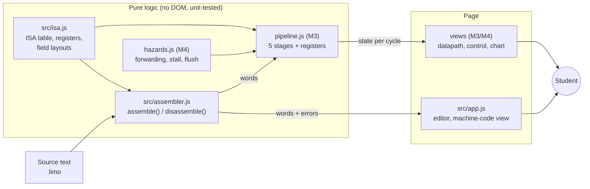
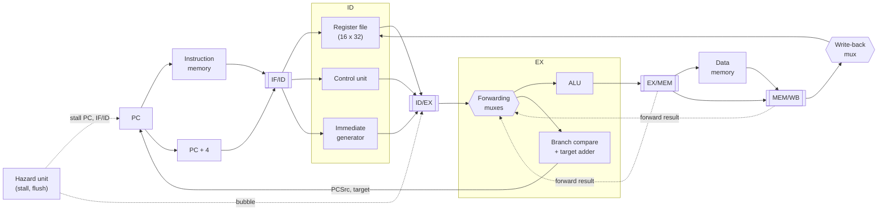

# LIMO – Milestone 2 design

Milestone 2 covers: **the frozen ISA** (D1 feedback applied), **architecture and block diagram**, the **pipeline-register data model**, **interface wireframes**, and a **working assembler with unit tests** on a live GitHub Pages site.

| Part | Status in M2 |
|---|---|
| 1. ISA (frozen) | Specified here and in `src/isa.js` |
| 2. Architecture and block diagram | Designed here |
| 3. Pipeline-register data model | Designed here (built in M3) |
| 4. Interface wireframes | Designed here; the Editor view is already live |
| 5. Assembler and unit tests | Implemented: `src/assembler.js`, `tests/assembler.test.js` |

Everything in sections 2–4 marked *later* is design only. No pipeline code exists yet.

---

## 1. The frozen ISA

### 1.0 D1 feedback applied

> **Team: fill this in before you tag `m2`.** List each change the examiner asked for at D1 and where it was made. Every change must be made in `src/isa.js` (the one place the code reads the ISA from) and in this section.
>
> | D1 comment | Change made | Files touched |
> |---|---|---|
> | *(none recorded yet)* | | |

The tables below describe `src/isa.js` exactly as it is today.

### 1.1 Style

32-bit load–store machine. Byte-addressed, little-endian, word-aligned. Fixed 32-bit instructions. Only `nka` (load) and `beha` (store) touch memory.

### 1.2 Registers

16 general-purpose registers (4-bit register fields). **Effect of the choice:** 4-bit fields for `rd`, `rs1`, `rs2` free bits for a 14-bit immediate (range −8192 … 8191) and a 10-bit `funct7`. The forwarding comparators later compare 4 bits, not 5.

| Reg | Alias | Sesotho | Reg | Alias | Sesotho |
|---|---|---|---|---|---|
| x0 | zero | khoamo | x8 | t3 | nakoana |
| x1 | ra | bolulo | x9 | s0 | boloka |
| x2 | sp | khetsi | x10 | s1 | boloka |
| x3 | a0 | karabo | x11 | s2 | boloka |
| x4 | a1 | karabo | x12 | s3 | boloka |
| x5 | t0 | nakoana | x13 | s4 | boloka |
| x6 | t1 | nakoana | x14 | s5 | boloka |
| x7 | t2 | nakoana | x15 | s6 | boloka |

`x0` is hard-wired to zero. The PC is a separate programmer-visible register (not in the file).

### 1.3 Formats and encoding

All formats keep the same fields in the same bit positions, so the register-file read ports and the forwarding comparators never depend on the format.

```
bit  31        22 21   18 17   14 13  11 10    7 6      0
R    funct7[9:0]  rs2     rs1     f3     rd      opcode
I    imm[13:0] ------------>  rs1     f3     rd      opcode      (imm occupies 31:18)
S/B  imm[13:4]    rs2     rs1     f3     imm[3:0] opcode
```

Load (`nka`) uses the I layout. Store (`beha`) uses S. Branches use B (same layout as S).

| Mnemonic | Fmt | opcode | funct3 | funct7 | Operation | RV32I |
|---|---|---|---|---|---|---|
| `kopanya` | R | 0x33 | 0 | 0 | rd = rs1 + rs2 | add |
| `tlosa` | R | 0x33 | 0 | 32 | rd = rs1 − rs2 | sub |
| `ritsisa_t` | R | 0x33 | 1 | 0 | rd = rs1 << rs2[4:0] | sll |
| `kopanya_h` | I | 0x13 | 0 | – | rd = rs1 + imm | addi |
| `ritsisa_ht` | I | 0x13 | 1 | – | rd = rs1 << imm (0–31) | slli |
| `ritsisa_hl` | I | 0x13 | 5 | – | rd = rs1 >> imm (logical, 0–31) | srli |
| `nka` | I | 0x03 | 2 | – | rd = mem[rs1 + imm] | lw |
| `beha` | S | 0x23 | 2 | – | mem[rs1 + imm] = rs2 | sw |
| `lekana` | B | 0x63 | 0 | – | if rs1 == rs2: PC = PC + imm | beq |
| `fapana` | B | 0x63 | 1 | – | if rs1 != rs2: PC = PC + imm | bne |

The Sesotho meaning of each mnemonic is in the M1 glossary.

**Branch offset.** `imm` is in **bytes, relative to the address of the branch itself**. The assembler computes it from a label: `imm = label address − branch address`. A numeric branch target is not accepted, because it could mean either an offset or an address; write a label.

**Immediates.** 14-bit two's complement: −8192 … 8191. Shift amounts are 0 … 31.

### 1.4 Hand-encoded examples (one per format)

These words are asserted by `tests/assembler.test.js`, derived by hand and not copied from the assembler.

| Instruction | Fields | Binary | Hex |
|---|---|---|---|
| `kopanya x7, x5, x6` (R) | f7=0, rs2=6, rs1=5, f3=0, rd=7, op=0x33 | `0000000000 0110 0101 000 0111 0110011` | `0x001943B3` |
| `kopanya_h x5, x0, 10` (I) | imm=10, rs1=0, f3=0, rd=5, op=0x13 | `00000000001010 0000 000 0101 0010011` | `0x00280293` |
| `nka x8, 4(x2)` (load) | imm=4, rs1=2, f3=2, rd=8, op=0x03 | `00000000000100 0010 010 1000 0000011` | `0x00109403` |
| `beha x7, 8(x2)` (S) | imm[13:4]=0, rs2=7, rs1=2, f3=2, imm[3:0]=8, op=0x23 | `0000000000 0111 0010 010 1000 0100011` | `0x001C9423` |
| `lekana x1, x2, +8` (B) | imm[13:4]=0, rs2=2, rs1=1, f3=0, imm[3:0]=8, op=0x63 | `0000000000 0010 0001 000 1000 1100011` | `0x00084463` |

### 1.5 Lexical rule for apostrophes

Sesotho orthography uses an apostrophe (ts', ch'). Keyboards and fonts differ, so the assembler treats the apostrophe `'`, the backtick `` ` `` and the curly quotes `’` `‘` as the same character as the underscore `_`. `kopanya'h`, ``kopanya`h``, `kopanya’h` and `kopanya_h` assemble to the same word. The rule applies to mnemonics and labels. Mnemonics are not case-sensitive; labels are.

### 1.6 Assembly syntax

- One instruction per line; an optional `label:` before it, or on a line of its own.
- Comments start with `#` or `//` and run to the end of the line.
- Operands: registers as `x0`–`x15` or an alias; immediates in decimal or `0x` hex, optionally signed; memory as `offset(register)`.

---

## 2. Architecture and block diagram

### 2.1 Software architecture

The code is split so that everything that matters can be tested without a browser. The first two modules never touch the page.



Implemented in M2: `isa.js`, `assembler.js`, `app.js`. Marked *(M3)* / *(M4)*: designed, not yet written.

**Rules of thumb.** `isa.js` is the only file that knows the ISA. `assembler.js` returns data and never throws on bad source; it returns a list of `{line, message}`. `app.js` only draws. The same files load as classic scripts in the browser and as `require()` modules in Node, so there is no build step and the page works from a double-click.

### 2.2 Processor block diagram (what the simulator will model)



**Design decisions that shape the model** (each is defended in the A6 log):

| Decision | Choice | Cost / benefit |
|---|---|---|
| Where branches resolve | In **EX** | A taken branch flushes 2 instructions (IF/ID and ID/EX). Resolving in ID would flush 1 but needs a comparator and an adder in ID and a forwarding path into it. |
| Forwarding | From EX/MEM and MEM/WB into the EX inputs | Removes stalls for ALU-to-ALU dependencies. |
| Load-use | One-cycle stall, then forward from MEM/WB | A loaded value only exists after MEM, so the dependent instruction cannot be in EX in the next cycle even with full forwarding. |
| Register file | Written in the first half of the cycle and read in the second | A value written back in WB is visible to an instruction reading in ID the same cycle. |
| Memories | Separate instruction and data memory | No structural hazard between IF and MEM. |

---

## 3. Pipeline-register data model

The simulator state is plain data, one object per register, copied each cycle. This is what the datapath view will read and what **Step Back** will restore. An invalid (bubble) register has `valid: false` and every other field is ignored.

```js
// One pipeline register after the clock edge. "ctl" is the control bundle that travels with the instruction.
IF/ID  = { valid, pc, pcPlus4, instr }
ID/EX  = { valid, pc, instr, rs1, rs2, rd, rs1Val, rs2Val, imm, funct3,
           ctl: { RegWrite, ALUSrc, ALUctl, MemRead, MemWrite, MemtoReg, Branch } }
EX/MEM = { valid, pc, instr, rd, aluResult, storeData, branchTaken, branchTarget,
           ctl: { RegWrite, MemRead, MemWrite, MemtoReg, Branch } }
MEM/WB = { valid, pc, instr, rd, aluResult, memData,
           ctl: { RegWrite, MemtoReg } }

// Whole machine state
State  = { pc, cycle, regs[16], instructionMemory[], dataMemory{addr: word},
           ifid, idex, exmem, memwb, stats: { retired, stalls, flushes },
           trace }   // trace = the values on each wire in the cycle just run, for the views
```

| Field | Width | Set in | Used in | Meaning |
|---|---|---|---|---|
| `pc` | 32 | IF | all (display) | Address of the instruction; kept so the views can show which instruction is in each stage |
| `pcPlus4` | 32 | IF | EX | Fall-through address |
| `instr` | 32 | IF | ID | The machine word |
| `rs1`, `rs2`, `rd` | 4 | ID | EX (forwarding compare), MEM, WB | Register numbers, kept so the forwarding unit can compare them |
| `rs1Val`, `rs2Val` | 32 | ID | EX | Operands read from the register file (before forwarding) |
| `imm` | 32 (from 14) | ID | EX | Sign-extended immediate; for branches, the byte offset |
| `funct3` | 3 | ID | EX | Selects the ALU operation or branch condition |
| `ctl.*` | 1 bit each (`ALUctl` 2–3 bits) | ID | EX, MEM, WB | Control signals; each stage drops the signals it has finished using |
| `aluResult` | 32 | EX | MEM, WB | ALU output or memory address |
| `storeData` | 32 | EX | MEM | `rs2` after forwarding; the value `beha` writes |
| `branchTaken`, `branchTarget` | 1, 32 | EX | IF (PCSrc) | Branch outcome and target = `pc + imm` |
| `memData` | 32 | MEM | WB | Word read by `nka` |

**Control signals** (generated in ID, B4):

| Signal | Meaning |
|---|---|
| RegWrite | The instruction writes a register in WB |
| ALUSrc | ALU input B is the immediate (1) rather than `rs2` (0) |
| ALUctl | Which operation the ALU performs (ADD, SUB, SLL, SRL) |
| MemRead | Read data memory (`nka`) |
| MemWrite | Write data memory (`beha`) |
| MemtoReg | Write-back value comes from memory (1) rather than the ALU (0) |
| Branch | The instruction is a conditional branch |
| PCSrc | Next PC is the branch target (branch AND condition true), decided in EX |

Registers that exist **only in the microarchitecture** (the four pipeline registers above) are not part of the ISA: a different LIMO implementation could pipeline differently and run the same programs.

---

## 4. Interface wireframes

### 4.1 Editor view (live now)

```
+--------------------------------------------------------------------------------------+
| [⚙ Assemble] [ Open .limo] Example [Choose… v] | (•) Hex ( ) Binary    LIMO assembler |
+-------------------------+-------------------------------+----------------------------+
| Source code  [Assembled]| Machine code                  | GPR  [Hex v]               |
| 1 # Sum of 1..5 ...     | 0000 0x00000293 kopanya_h ..  | Mnemonic Fmt Operands RV32I|
| 2   kopanya_h x5,x0,0   | 0004 0x00140313 kopanya_h ..  | Name Alias·Sesotho Value   |
| 3   kopanya_h x6,x0,5   | 0008 0x001942b3 loop: kopanya | x0 zero·khoamo 0x00000000  |
| 4 loop: kopanya x5,x5,x6| 000c 0xfffd8313 kopanya_h ..  | x1 ra·bolulo   0x00000000  |
| ...                     | 0010 0xffc18c63 fapana x6,..  | PC sebaka      0x00000000  |
+-------------------------+-------------------------------+----------------------------+
| 6 instructions, 24 bytes   opcode rd funct3 rs1 rs2 imm funct7   (colour-coded fields)|
+--------------------------------------------------------------------------------------+
| Messages                                                                             |
| ✗ Line 2: "bogus" is not a LIMO instruction. Check the spelling ...   (click to jump)|
+--------------------------------------------------------------------------------------+
| status text                                  LIMO · 32-bit · 16 registers · 14-bit imm|
+--------------------------------------------------------------------------------------+
```

The GPR table shows all 16 registers plus the PC (*sebaka*) in hex or decimal. In M2 no program runs, so every value is 0; the table already takes a values array and a "just written" index, which the M3 pipeline will supply. Behaviour: the page assembles as you type (and on **Assemble** / Ctrl+Enter). Errors list every problem with its line number; clicking one selects that line. In Binary mode the fields are colour-coded **and underlined**, and each carries a tooltip with its name, so colour is never the only cue.

### 4.2 Processor view (design only; built in M3–M4)

```
+------+-------------------------------------------------------------+-----------------+
|Editor|  [Datapath] [Control]                                       | Registers       |
|      | +---------------------------------------------------------+ | x0 zero khoamo 0|
|Proce-| | PC -> [IM] -> IF/ID -> [RF][Ctrl][Imm] -> ID/EX -> [ALU]| | x1 ra   bolulo 0|
|ssor  | |  ^                                          |           | | ...             |
|      | |  +-------- branch target / PCSrc -----------+           | +-----------------+|
|      | |  ... -> EX/MEM -> [DM] -> MEM/WB -> WB mux -> RF        | | Instruction mem |
|      | +---------------------------------------------------------+ | BP Addr Stage   |
|      |  active units and wires highlighted, live values on wires   | [ ] 0000 IF ... |
|      |                                                             +-----------------+|
|      |                                                             | Execution info  |
|      |                                                             | cycles, stalls..|
+------+-------------------------------------------------------------+-----------------+
| Console / narration                                                                  |
+--------------------------------------------------------------------------------------+
| [⚙] [↻ Reset] [‹ Back] [› Step] [▶ Run / Pause]  delay [300] ms                       |
+--------------------------------------------------------------------------------------+
```

The **Control** tab replaces the datapath with a table: one row per signal, one column per stage (ID, EX, MEM, WB), a one-line meaning per row, and bubbles marked. The toolbar and the console are shared by both tabs.

---

## 5. Assembler design and tests

### 5.1 How it works

Two passes over the source lines:

1. **Pass 1.** Strip comments, record labels (address = instruction count × 4), parse each instruction's operands. A bad line is recorded as an error and still reserves its address slot, so one mistake does not cause false errors in later branches.
2. **Pass 2.** Replace each branch label by `label address − branch address`; report unknown labels and branch offsets outside −8192 … 8191.

If there are any errors, `assemble()` returns `ok: false`, the full list of `{line, message}` and no machine code. Otherwise each instruction is packed by `encode()` into its 32-bit word. `disassemble()` reverses it, which gives the round-trip tests and the text shown beside each word.

### 5.2 Unit tests

`npm test` runs `tests/assembler.test.js` (Node 20+, no dependencies).

| Area | What is checked |
|---|---|
| Encoding | One hand-derived word per format (R, I, load, S, B); `tlosa`/`kopanya` differ only in funct7; negative immediates; S/B immediate split across `imm[13:4]` and `imm[3:0]` |
| Labels and offsets | Forward and backward offsets; label alone on a line; label used before it is defined; branch to itself; branch at the 14-bit limit accepted, beyond it rejected |
| Apostrophe rule | `'`, `` ` ``, `’`, `‘`, `_` give identical words, in mnemonics and labels; mnemonic case-insensitivity |
| Numbers and registers | Decimal, hex, signed; −8192 and 8191 accepted, −8193 and 8192 rejected; shift range 0–31; `x0`–`x15` and aliases; `x16` rejected |
| Errors | Correct line numbers past comments and blank lines; **all** errors reported; wrong operand count, bad memory operand, unknown/duplicate label, non-number; failure returns no machine code; a bad line does not shift later addresses |
| Source handling | `#` and `//` comments, blank lines, empty source, Windows line endings, addresses step by 4 |
| ISA consistency | Every instruction round-trips through assemble → disassemble; field layouts cover bits 31–0 exactly once; no two instructions share an opcode/funct combination; fields rebuild the word |
| Examples | Each `examples/*.limo` assembles with no errors; `src/examples.js` matches the files on disk |

---

## 6. Repository layout

```
index.html, style.css     the live page (Editor view)
src/isa.js                ISA definition – the one place to change the ISA
src/assembler.js          assemble() and disassemble()
src/examples.js           GENERATED from examples/*.limo (npm run examples)
src/app.js                page wiring
tests/assembler.test.js   unit tests
examples/*.limo           sample programs
docs/DESIGN.md            this document
```
